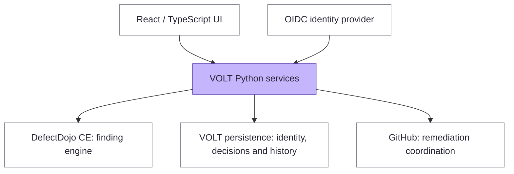

<p align="center">
  
</p>

# VOLT

**Vulnerability Ownership & Lifecycle Tracking**

**Connect vulnerability findings to accountable owners, governed decisions and measurable remediation.**

VOLT is an open-source vulnerability lifecycle application built around [DefectDojo Community Edition](https://github.com/DefectDojo/django-DefectDojo). It brings vulnerability identity, ownership, assessment and remediation workflows into a shared model for security teams, engineering teams and governance stakeholders.

Its focus is continuity and accountability: understanding which workloads are affected, who owns the outstanding work, which decisions apply and what evidence supports a change in status.

[RC2 Compose image](docs/installation.md#rc2-compose-installation) · [Historical RC1 release](https://github.com/njvenis/volt/releases/tag/v0.1.0-rc.1) · [Getting started](#getting-started) · [Architecture](#architecture) · [Documentation](#documentation) · [Contributing](CONTRIBUTING.md) · [Apache-2.0 licence](LICENSE)

> [!IMPORTANT]
> **Primary installation: VOLT 0.1.0-rc.2 with Docker Compose.** The compatible Linux/amd64 image is published at `ghcr.io/njvenis/volt@sha256:a7130e38b88b781d93d84c4ddd022ba45716a06b89949a2923e1dd531db2eac1`. The source-free Compose bundle and signed offline archive will be linked from the [RC2 prerelease page](https://github.com/njvenis/volt/releases/tag/v0.1.0-rc.2) after the release owner completes the separate tag/release handoff; until then, treat that asset handoff as pending. The signed archive also contains the bundle. RC1 remains an immutable historical launcher release and does not satisfy the Compose contract. Neither release is production-ready. See [RC2 installation](docs/installation.md#rc2-compose-installation), [historical RC1 installation](docs/installation.md#historical-rc1-launcher), and [verification boundaries](GATES.md).

## Why VOLT?

Vulnerability management involves more than collecting findings. Workloads are rebuilt, ownership changes, exceptions expire and remediation happens incrementally. Teams need to retain the history behind those changes without losing sight of the remaining exposure.

VOLT is being developed for organisations that need:

- **Security operations:** consistent finding identity and visibility into incomplete or stale source evidence.
- **Engineering teams:** accountable ownership and remediation of explicitly identified affected instances.
- **Governance stakeholders:** traceable assessments, approval boundaries and reporting that distinguishes accepted risk from completed remediation.
- **Platform teams:** a self-hosted application with explicit dependency, persistence and operational boundaries.

DefectDojo CE remains the finding engine. VOLT adds its own lifecycle and ownership model through supported interfaces and separate persistence.

## Core capabilities

The following areas describe the product and its development scope. See the linked contracts for requirements and the [verification status](#verification-and-deployment-status) for what the available evidence establishes.

| Area | Purpose | Further detail |
| --- | --- | --- |
| Vulnerability identity | Group by namespaced source-native identifiers; preserve CVE relationships without merging distinct vulnerabilities solely because they share a CVE. | [Identity requirements](REQUIREMENTS.md#cr-02--native-grouping) |
| Workload continuity | Retain logical workload identity, detection history and decision context across verified rebuilds; make ambiguous matches explicit. | [Continuity requirements](REQUIREMENTS.md#cr-03--rebuild-continuity) |
| Ownership and access | Associate work with people and teams while keeping accountable ownership separate from permission to approve or change a decision. | [Access and ownership contract](docs/g7-native-access-ownership-api-contract.md) |
| Assessment governance | Model severity overrides, time-bounded risk acceptance, approval limits and auditable changes against defined affected membership. | [Assessment requirements](REQUIREMENTS.md#fr-as-01--overrides) |
| Remediation workflows | Track partial remediation and coordinate GitHub issues with ownership and lifecycle state. | [GitHub requirements](REQUIREMENTS.md#fr-gh-01--single-issue) |
| Reporting and SLAs | Distinguish SLA coverage gaps, overdue exposure, accepted risk and remediation, with historical reporting context. | [Reporting requirements](REQUIREMENTS.md#fr-me-01--sla-coverage) |

The design treats **evidence, decisions and remediation as distinct concepts**. Missing or incomplete scanner results must not become evidence of remediation. Risk acceptance and exclusions must not count as patching. Scanner refreshes must preserve human decisions and audit history. These invariants are documented in [GATES.md](GATES.md).

## Getting started

### Install the RC2 Compose release

Use the [RC2 installation guide](docs/installation.md#rc2-compose-installation) and its signed source-free Compose bundle for new evaluation installations. Online pulls use the immutable registry digest above. The bundle requires Docker Compose v2, Python 3.11+ and OpenSSL; it does not build or clone application source. External evaluation also requires a provider-specific trusted identity-sync publisher; OIDC login alone does not establish current source permissions.

### Historical RC1 launcher

Follow the [historical RC1 launcher guide](docs/installation.md#historical-rc1-launcher) to verify and run that published image without rebuilding. The [RC1 release page](https://github.com/njvenis/volt/releases/tag/v0.1.0-rc.1) provides its immutable digest, signed offline bundle, SBOMs and verification evidence. RC1 cannot be used with the RC2 Compose installer.

The historical launcher binds the application and synthetic OIDC provider to loopback, generates private local secrets and creates owned persistent volumes. Use synthetic data and disposable resources. RC1 is an evaluation release, not a production installation recipe; installing DefectDojo separately does not install VOLT.

For source builds, use the [development preview guide](docs/local-preview.md).

## Architecture

Logical application boundaries; this diagram does not prescribe separate containers or establish live integration compatibility.



**DefectDojo boundary.** VOLT uses supported interfaces and does not write directly to DefectDojo database tables. Upstream installation documentation describes DefectDojo itself.

**Application boundary.** Python services live in `uvm/`, with SQLAlchemy models and Alembic migrations. The internal package name remains `uvm` for compatibility. The React, TypeScript and Vite frontend lives in `ui/`.

**Identity and authority.** OIDC establishes identity; VOLT's access model governs application actions and scopes. Ownership-team membership is separate from access-group authority. The [native access contract](docs/g7-native-access-ownership-api-contract.md) details current authority checks, bounded grants and audited administration.

**Packaging.** RC1 remains a signed historical Linux/amd64 image with its own offline bundle. RC2 adds the Compose-compatible image and a source-free Compose bundle published separately and included in the signed offline archive, bound to registry digest `sha256:a7130e38b88b781d93d84c4ddd022ba45716a06b89949a2923e1dd531db2eac1`. `Dockerfile.g7` remains the build recipe using pinned DefectDojo CE and Valkey images. See [installation](docs/installation.md), [deployment boundaries](docs/deployment.md) and [third-party notices](THIRD-PARTY-NOTICES.md).

## Verification and deployment status

| Area | Current position |
| --- | --- |
| Identity and ingestion | Synthetic local suites exercise source-native grouping, rebuild history, completeness, freshness, replay and conflict handling. |
| RC1 evaluation | Published image and offline bundle; the [release workflow](https://github.com/njvenis/volt/actions/runs/41804175229) passed synthetic sign-in, audited-operation, ingress-denial and restart-persistence checks. |
| RC2 Compose evaluation | Published digest-pinned image; hosted Compose, cold-restore and offline-preview qualification passed. The scan gate reported 888 findings and zero fixable High/Critical findings; this is not a claim of zero vulnerabilities. Signed offline assets are linked from the prerelease page after the separate release handoff. |
| External integrations | Local tests do not establish compatibility with live scanners, enterprise identity providers, GitHub or other external services. |
| Enterprise deployment | No supported production deployment or end-user installer. Security, recovery, operational and integration qualification remain separate requirements. |
| G7 operational scenarios | Acceptance goals in OpenSpec; their presence does not establish implementation or successful execution. |

Evidence should identify the exact revision, commands, environment and result. A fixture result is **synthetic/local**; **integration verified** requires the named real service and version. **Production readiness** is a separate release decision. See [GATES.md](GATES.md) for these definitions and [REQUIREMENTS.md](REQUIREMENTS.md) for the target baseline.

## Documentation

| I want to… | Start here |
| --- | --- |
| Find configuration, deployment boundaries, and operations guidance | [Documentation index](docs/README.md) |
| Install the current Compose release | [RC2 Compose installation](docs/installation.md#rc2-compose-installation) |
| Run the historical launcher release | [RC1 launcher installation](docs/installation.md#historical-rc1-launcher) |
| Build a development preview | [Development preview](docs/local-preview.md) |
| Understand product scope and invariants | [Requirements](REQUIREMENTS.md) |
| Assess verification and maturity | [Development and verification](GATES.md) |
| Build and validate the project | [Development runbook](RUNBOOK.md) |
| Review permissions and ownership | [Native access and ownership contract](docs/g7-native-access-ownership-api-contract.md) |
| Contribute a change | [Contributing](CONTRIBUTING.md) |
| Report a security concern | [Security policy](SECURITY.md) |
| Review licensing and redistribution | [Licence](LICENSE) · [Third-party notices](THIRD-PARTY-NOTICES.md) |

## Development

Prerequisites: Python 3.13.15 (matching CI), [uv](https://docs.astral.sh/uv/) (CI pins 0.12.18), Node.js 24.21.0 and npm. From the repository root:

```sh
uv sync --locked --python 3.13.15
npm --prefix ui ci
npm --prefix ui run build
npm --prefix tools/g0_ci/openspec ci
tools/g0_ci/openspec/node_modules/.bin/openspec validate --all --strict
```

These commands install development dependencies, build the UI and validate specifications. They do not start the complete application.

Run the core synthetic and in-process checks:

```sh
uv run python -m unittest discover -s tests/engine -v
uv run python -m unittest discover -s tests/identity -v
uv run python -m unittest tests.ingestion.test_run -v
```

See the [development runbook](RUNBOOK.md) and [contribution guide](CONTRIBUTING.md) for the workflow and change-specific checks.

## Security and responsible evaluation

Use synthetic data for development and evaluation. Keep credentials, raw vulnerability records, private environment identifiers, reports and production exports out of commits, issues and pull requests.

Report vulnerabilities through [GitHub private vulnerability reporting](https://github.com/njvenis/volt/security/advisories/new), which is enabled. Read [SECURITY.md](SECURITY.md) for the requested details. Do not disclose sensitive details in public issues. Reports are handled on a best-effort basis, with no response-time or remediation SLA.

## Contributing

Contributions should be focused, reproducible and supported by evidence. Open an issue before starting a large change so its scope and interfaces can be reviewed. Include the rationale, relevant documentation changes and exact check results, identifying any services replaced by fixtures.

See [CONTRIBUTING.md](CONTRIBUTING.md) for the full workflow.

## Licence and acknowledgements

VOLT source is licensed under the [Apache License 2.0](LICENSE). DefectDojo CE and Valkey are upstream dependencies with their own licences; see [THIRD-PARTY-NOTICES.md](THIRD-PARTY-NOTICES.md).

RC1 includes image-specific notices and source evidence in its signed offline bundle. The [notice manifest](https://github.com/njvenis/volt/releases/download/v0.1.0-rc.1/notice-manifest.json) identifies that inventory. Every new image build requires its own collection and verification; source notices alone do not cover a changed image.

The name **VOLT** is provisional and subject to trademark clearance.
